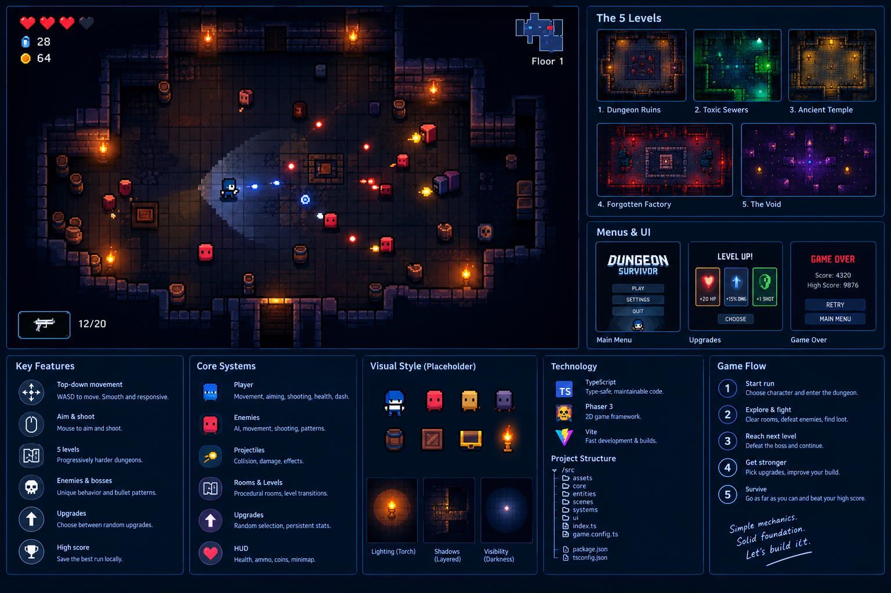

# Ninja Survivor (formerly Dungeon Survivor)

A compact, original top-down dungeon shooter with a 16-bit-inspired
pixel look. Fight through five themed levels of hand-authored rooms,
pick upgrades, and defeat the final boss. It is inspired by the broad
room-based action genre; no characters, rooms, assets or names are taken
from other games.

**Play online:** https://website.cookiewarrior.io/dungeon-survivor-claude-project/
(published by GitHub Pages on every push to `main`; see
`.github/workflows/deploy.yml`).

**Status: v2.0 (Ninja Survivor)** (see `docs/GAME_DESIGN.md` and
`docs/TASKS.md`). It is playable from the village prologue through five
levels to victory or game over, with pixel art, sound effects and music
from the CC0 **Ninja Adventure** pack by Pixel-boy and AAA (see
`CREDITS.md`). TypeScript
(strict), Phaser 3, Vite, Vitest. It is offline-only: there is no
backend, accounts or online leaderboard.



## Run it

Requires Node.js (developed on Node 24 / npm 11).

```text
npm install
npm run dev          # play at http://127.0.0.1:5173
```

| Command | What it does |
|---|---|
| `npm run dev` | Dev server with hot reload |
| `npm run typecheck` | `tsc --noEmit` (strict, no unused locals or parameters) |
| `npm test` | Vitest unit tests (pure game logic, no browser needed) |
| `npm run build` | Typecheck, then production build into `dist/` |
| `npm run preview` | Serve the production build locally |

URL flags:

| Flag | Effect |
|---|---|
| `?debug` | Draw physics bodies |
| `?nolight` | Turn the lighting off |
| `?art=placeholder` | Use the original generated shapes instead of sprites |
| `?artroom` | Open the art test room (one room with every enemy type, props and torches) |
| `?artroom&theme=sewers` | Test room in another level's look (`ruins`, `sewers`, `temple`, `foundry`, `void`) |
| `?artroom&boss` | Test room with the boss added |
| `?testmap` | v2 engine test map: scrolling camera, tall walls, water, gated encounter areas with waves and an ambush |
| `?testmap=world&theme=forest` | v2 world-kit test maps, one per biome (`theme`: `village` peaceful with houses and lanes, `forest` dense with a hollow, `river` with a bridge ambush, `snow` with a frozen lake to slide on and no animals) |

## Art and audio

Sprites, tiles, effects, sounds and music come from the **Ninja
Adventure** asset pack by Pixel-boy and AAA (CC0, credited in
`CREDITS.md`). Only the files in use are included, in
`public/assets/ninja/`:
-   72 sheets (452 KB), listed in `src/data/artManifest.ts` with their
    frames, animations and original pack paths;
-   28 sound effects (2.3 MB, preloaded) and 12 music tracks (12 MB,
    streamed one at a time), listed in `src/data/audioManifest.ts` with
    their sources and volumes.

Each level has its own track, boss fights switch to fight music (the
Hollow Warden has its own), and the results screen plays a victory or
defeat theme. Press **N** to turn sound off or on; the choice is
remembered in this browser.

-   **Hitboxes are separate from the art** (`src/data/hitboxes.ts`,
    locked by tests), so changing sprites never changes gameplay.
-   **Missing sheets fall back to the generated placeholder art** with a
    console warning, instead of breaking the game.

## Controls

| Input | Action |
|---|---|
| WASD | Move (diagonals are normalised) |
| Mouse | Aim |
| Hold left mouse | Shoot |
| Space | Dash (brief invulnerability; meter under HP) |
| E | Talk to the merchant / shopkeeper, or use an open door |
| Esc / P | Pause / resume (M on the pause screen quits to the menu) |
| N | Sound on / off (menu, game and pause screen) |
| 1 / 2 / 3 or click | Pick an upgrade |
| 1–6 or click, Esc / E | Buy in a shop, leave the shop |
| R / click, M | Retry or menu on the results screen |

## How a run works

-   **Home Village:** every run starts in a peaceful village. Signs,
    training dummies and a dash lane teach the controls (optional), the
    old shopkeeper sells weapon unlocks, and the gate a few steps east
    (press E) starts the run. Time and score start at the gate.
-   **Five levels in order:** Bamboo Forest → River → Snowy Mountain →
    Abandoned Village → The Void. Each is one large hand-made map with
    its own monsters, light, terrain and difficulty:
    -   **Bamboo Forest:** the baseline.
    -   **River:** water blocks walking but not bullets; bridges are the
        crossings.
    -   **Snowy Mountain:** you slide on ice.
    -   **Abandoned Village:** night, lanterns and street ambushes.
    -   **The Void:** broken platforms over the abyss. Step off and you
        fall (1 HP, back to a safe spot); dash to cross a gap of 1–2
        tiles.
-   **Fights:** walking into a fight area (or across an ambush trigger)
    seals its gates until its waves are beaten. Each level has a
    mini-boss with a wave, and ends with its boss (level 5: *The Hollow
    Warden*).
-   **Exit:** the level's exit, past the boss, opens once every fight is
    cleared. Stand at it and press E.
-   **Enemies:** every level dresses three behaviours in its own
    monsters:
    -   chasers rush you;
    -   tanks are slow and hit for 2;
    -   ranged shooters keep their distance. They stop, flash and draw an
        aim line before each shot, so watch for the line and dash.
-   **Health** carries over through a level and refills at each new
    level. The merchant also sells a full heal.
-   **Upgrades:** some fights offer three upgrades when cleared (two per
    level, one on the last; 9 per run), each capped. The options are
    damage, fire rate, bullet speed, move speed, max HP, and an extra
    bullet.
-   **Score:** enemies (worth more on deeper levels), plus level clears
    and a victory bonus.
-   **Coins:** enemies and breakable pots and crates drop coins, which
    fly to you when you're close (and all at once when an area is
    cleared). Victory banks every coin you carry; death or quitting banks
    half.
-   **Shops:** the travelling merchant near each level's start sells
    a full heal, run upgrades and your unlocked weapons, for pocket
    coins. The village shop (the old shopkeeper in the Home Village)
    unlocks weapons forever for saved coins: the Kunai
    (fast, pierces one), the Magic Shuriken (homing) and the Big Shuriken
    (heavy, pierces three). Every run starts with the basic shuriken.
-   **Results:** shows score, highest level, time, enemies defeated,
    levels cleared, best score, and coins earned, kept and saved. The save
    (best score, coins, unlocks) lives in the browser's local storage; an
    old v1 best score is carried over. If storage is blocked, the game
    still works and says "(not saved)".

## Tuning

Balance lives in data, not code:

-   `src/data/levels.ts`: the level order and per-level difficulty
    multipliers (enemy health and speed).
-   `src/data/*Level.ts`: each level's map, fights (areas, triggers,
    waves) and upgrade rewards. They are generated by authoring scripts
    and can also be edited by hand.
-   `src/data/bestiary.ts`: each level's monster looks, mini-boss and
    boss (health and attack).
-   `src/data/enemies.ts`: base enemy stats and attacks.
-   `src/data/weapons.ts` and `src/logic/economy.ts`: weapon stats,
    unlock and merchant prices, and coin drops.
-   `src/game/config.ts` (`Tuning`): player, dash, gun and room timings.
-   `src/logic/upgrades.ts`: upgrade amounts and caps.
-   `src/data/themes.ts`: palettes and lighting (darkness, torch colour,
    light radius).

Tests keep the values in safe bounds. For example, every enemy must stay
slower than the player, and the darkness is capped so threats stay
readable.

## Project layout

```text
src/
  main.ts          Phaser game config and scenes
  game/            Scenes (Boot, Menu, Game, Pause, Results) and config
  entities/        Player, Enemy
  systems/         Swept projectiles, coins, NPCs, critters, world objects, save
  rendering/       World bake (terrain, objects), lighting, particles, placeholder art
  ui/              HUD, upgrade, shop and dialog panels
  data/            Level maps, village, biomes, decor, bestiary, weapons, art manifest
  logic/           Pure, Phaser-free rules (unit tested): encounters,
                   flow-field paths, ice, abyss, economy, terrain art, ...
tests/             Vitest suites for logic/, data/ (every map is validated) and storage
docs/              Spec, architecture, tasks, test plan, decisions log
```

Maps are ASCII grids, documented in `src/logic/layout.ts`:
-   `#` wall, `.` floor, `P` player start, `E` enemy spawn, `D` exit;
-   `~` water, `=` bridge, `:` path, `i` ice, `_` abyss;
-   `G` gate (closes while its fight is on);
-   `T` torch wall, `c` crate, `b` barrel (v1 rooms).

Decoration, NPCs and animals are placed as data next to each map.

## Known issues and limitations

-   **Balance:** tuned from scripted measurement runs (a bot that never
    dodges, plus kill times against perfect aim) and the levels you
    played. It has not had broad playtesting, and the merchant's prices
    were not measured (the bot never buys).
-   **Enemies ignore ice** (by design, first version), and melee enemies
    cannot cross the abyss or water: they go round, or wait.
-   **Audio:** tracks and effects were chosen by title and by measured
    length and loudness, not by ear, so some picks may want swapping
    (one line each in `src/data/audioManifest.ts`). There is no volume
    slider (a Settings menu is out of scope), only N to mute. Browsers
    start sound only after the first click or key press, so the menu
    music may begin then. The pack's ambient loops (river, wind) were
    left out: as WAVs they are 3–4 MB each.
-   **Placeholder art** (`?art=placeholder`) draws ice as plain floor
    and the abyss like water; it is only a fallback.
-   **Lighting and frame cost:** measured as CPU time per frame in the
    browser on the development machine. GPU cost was not measured
    directly.
-   **Small windows:** text is small; the game scales to fit the window
    but has no UI scaling.
-   **Hidden tabs:** the browser pauses `requestAnimationFrame`, so the
    game freezes while the tab is hidden. This is by design and harmless.
-   **Best scores are per address:** the dev server (`:5173`) and
    `npm run preview` (`:4173`) are different origins, so they keep
    separate best scores.
-   **Bundle size:** Phaser is ~1.48 MB minified (~340 kB gzip), built
    as its own cached chunk.
-   **Phaser 3.90 bug worked around:** stopping any scene removes every
    scene's keyboard blur handler. The pause overlay sleeps instead of
    stopping, and the game scene re-registers its handler on every
    start. Details are in `docs/DECISIONS.md`.

## Documentation

-   `docs/GAME_DESIGN.md`: the v2 specification (authoritative; v1 is in
    `docs/archive/`).
-   `docs/TECHNICAL_ARCHITECTURE.md`, `docs/TEST_PLAN.md`.
-   `docs/TASKS.md`: milestone checklist.
-   `docs/DECISIONS.md`: every material decision, deviation and verified
    result, milestone by milestone.

The project began as a Claude Code starter pack (`CLAUDE.md`,
`docs/CLAUDE_FIRST_PROMPT.md`) and was built milestone by milestone.
